# OpenPrinter

Impresora **DTF (Direct To Film)** de código y hardware abiertos, diseñada desde
cero para construirse con herramientas de *maker*: impresora 3D, perfil de
aluminio 4040 y placas cortadas por un servicio de láser o agua.

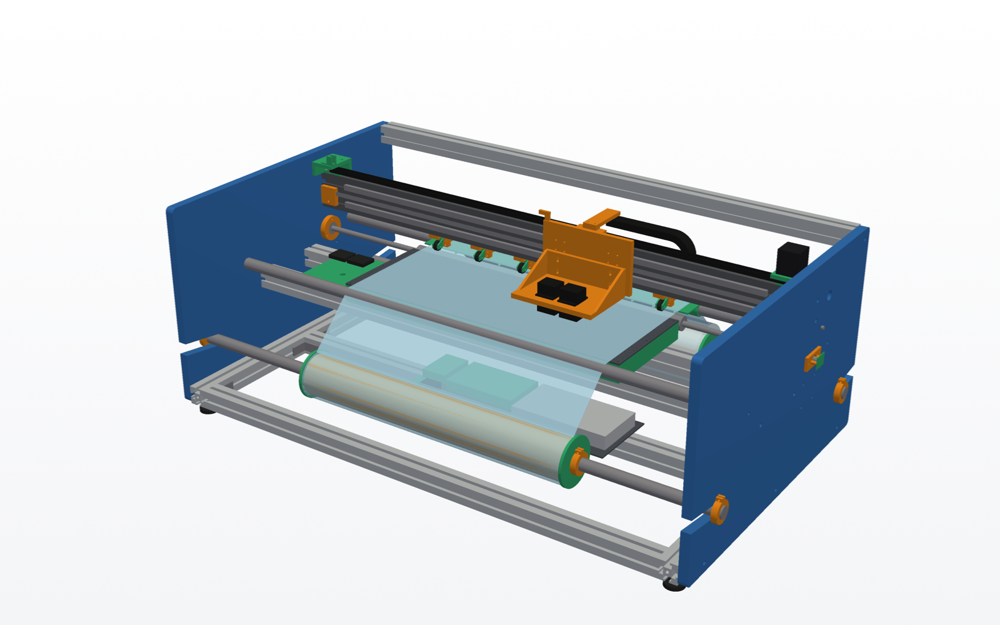

**[Modelo 3D interactivo](docs/model/openprinter.glb)** ·
**[Lista de compra de la fase 0](docs/compra_fase0.md)** ·
**[Fase 1: movimiento](docs/fase1_movimiento.md)** ·
**[Plan de diseño](PLAN.md)**

*Open source DTF (Direct To Film) printer, designed from scratch to be built
with maker tools. English summary at the end.*

> **Estado: fase 0, diseño mecánico.** Todavía no se ha fabricado ni probado
> nada. Las cotas pueden cambiar en cualquier momento. No compres material
> basándote en este repositorio hasta que una fase esté marcada como validada.

## Qué es DTF

La impresión DTF imprime con tinta pigmentada (CMYK más una capa de blanco) sobre
un film de PET. Sobre la tinta húmeda se espolvorea un adhesivo termofusible en
polvo, se cura con calor y el transfer resultante se plancha sobre la prenda.
Sirve para algodón, poliéster y mezclas, en prendas claras u oscuras.

## Por qué este proyecto

Las impresoras DTF comerciales de gama baja suelen ser impresoras de oficina
modificadas. Su mayor problema es la **tinta blanca**: el dióxido de titanio se
deposita y obstruye el cabezal si no circula. Además suelen tener firmware
cerrado y contadores de mantenimiento.

OpenPrinter quiere ser una máquina que se pueda entender, reparar y mejorar
pieza a pieza, con la circulación del blanco y el mantenimiento resueltos desde
el diseño.

## Alcance

### Objetivos

- **Formato**: rollo de film de 600 mm de ancho, configurable a 330 mm (A3+)
  cambiando un solo parámetro.
- **Color**: CMYK + blanco con un cabezal piezoeléctrico Epson XP600 (CMYK + WW),
  ampliable a dos con un cabezal dedicado al blanco ([análisis](docs/cabezales.md)).
- **Fabricación accesible**:
  - Chasis de perfil 4040 y dos placas laterales de aluminio (DXF incluido).
  - Carro, soportes y piezas auxiliares impresas en 3D.
  - Componentes comerciales estándar: guías MGN12, correa GT2, motores NEMA,
    rodamientos.
- **Diseño paramétrico y abierto**: CAD en Python (CadQuery). Todas las cotas
  salen de un único archivo y se exportan a STEP, STL y DXF.
- **Electrónica abierta**: Raspberry Pi como host y un microcontrolador
  (RP2040 o STM32) para el movimiento y la sincronización del disparo con un
  encoder lineal.
- **Software abierto**: un RIP propio que genere la capa de blanco, el tramado
  y las pasadas entrelazadas.
- **Driver de cabezal abierto**, el objetivo de investigación a largo plazo:
  una placa que genere la forma de onda y los datos del XP600 sin depender de
  placas cerradas.
- **Mantenimiento integrado**:
  - Recirculación y agitación de la tinta blanca.
  - Control de presión negativa.
  - Estación de servicio (*capping*, limpieza y purga).
- **Postproceso**: agitador de polvo y túnel de curado, como módulos aparte.

### Fuera de alcance

- No es una copia ni una modificación de ninguna impresora comercial.
- No se incluye firmware, documentación ni software propietario de Epson ni de
  terceros. Solo mediciones y desarrollos propios.
- No es un producto terminado ni certificado. Se ofrece sin garantía (ver
  licencias).
- No se usan cabezales térmicos (tipo HP45): la tinta DTF, y sobre todo el
  blanco, necesita un cabezal piezoeléctrico. Todas las pruebas se hacen
  directamente en DTF, con el XP600, tinta DTF y film.

## Hoja de ruta

| Fase | Contenido | Estado |
|---|---|---|
| 0 | Mecánica sin cubierta: chasis, viga X, carro, mesa de vacío, arrastre, rollos | Diseño completo, falta validar con piezas reales |
| 1 | Movimiento: motores, encoder, electrónica de control, firmware ([arquitectura](docs/fase1_movimiento.md)) | En diseño: arquitectura y piezas modeladas |
| 2 | Software: RIP abierto con capa de blanco, tramado y pasadas | Pendiente |
| 3 | Cabezal XP600: estudio de la señal, placa driver y primera impresión DTF sobre film | Pendiente |
| 4 | Tinta y servicio: presión negativa, circulación del blanco, estación de servicio | Pendiente |
| 5 | Postproceso: agitador de polvo y túnel de curado | Pendiente |
| 6 | Cubierta y cerramiento | Pendiente |

El detalle de la fase 0, con las convenciones, los módulos y las decisiones de
diseño, está en [PLAN.md](PLAN.md).

### Progreso de la fase 0

| # | Módulo | Estado |
|---|---|---|
| 0.1 | Esqueleto de distribución | Hecho |
| 0.2 | Chasis (placas laterales, bastidor 4040) | Hecho, falta validar con proveedor |
| 0.3 | Viga X (guías MGN12, motor, tensor, correa) | Primera versión |
| 0.4 | Carro impreso con ajuste de altura | Primera versión, faltan cotas reales del XP600 |
| 0.5 | Mesa de vacío (4 zonas con ventilador) | Primera versión |
| 0.6 | Arrastre Y (rodillo, presión con levante, motor 4:1) | Primera versión |
| 0.7 | Rollos, mandriles, freno y guías | Primera versión |
| 0.8 | Estación de servicio (base y volúmenes reservados) | Primera versión |

## Cómo es

| | |
|---|---|
| 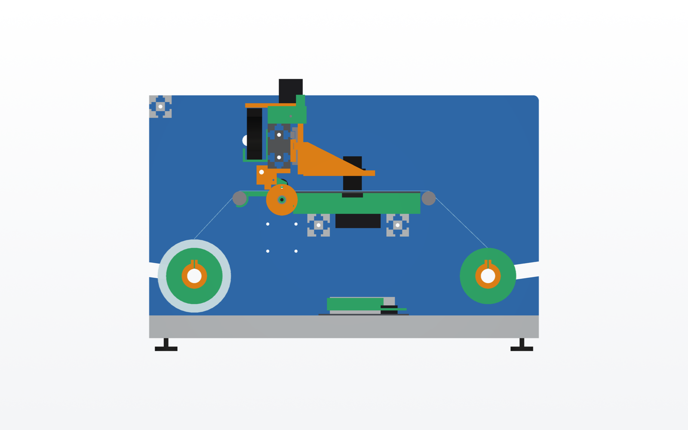 | 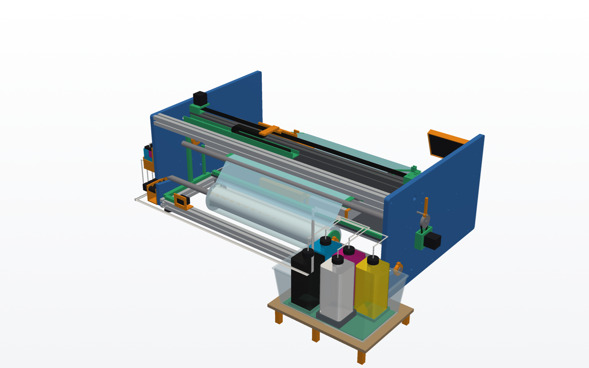 |
| **Sección lateral**: rollo de entrada, guía y mesa de entrada, rodillo con presión, mesa de vacío, guía delantera y rampa de salida | **Vista trasera**: viga 4080 con guías MGN12, motor X y correa |
| 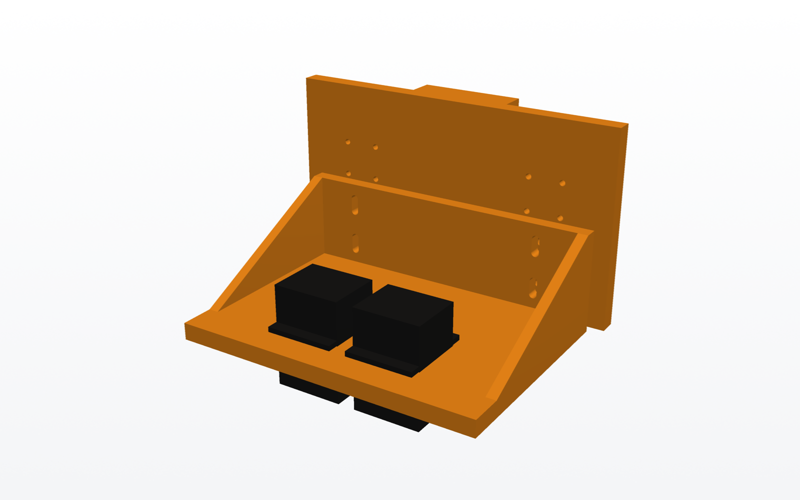 | 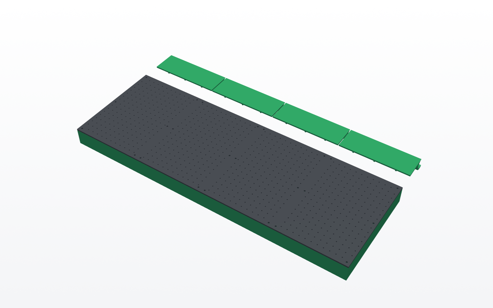 |
| **Carro impreso** con dos XP600 (maqueta) y ajuste de altura | **Mesa de vacío**: placa perforada sobre 4 cámaras con ventilador |
| 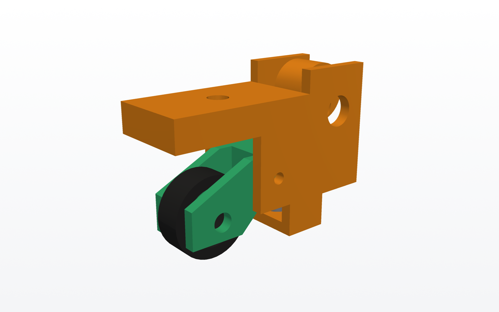 | 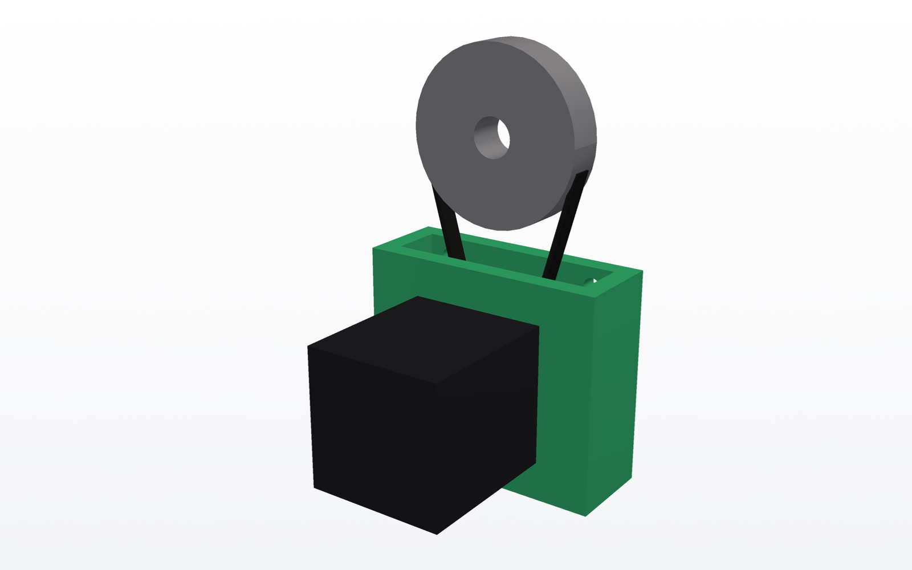 |
| **Unidad de presión** con leva de levante | **Motor Y** con reducción 4:1 |
| 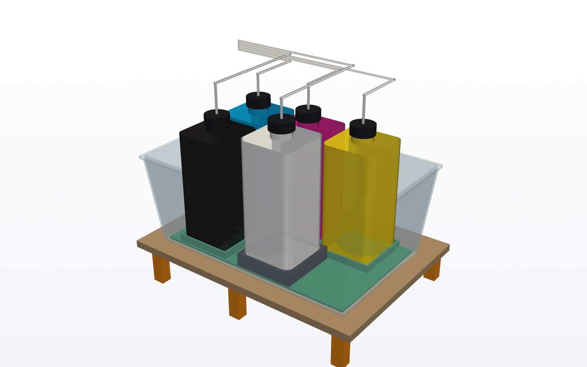 | 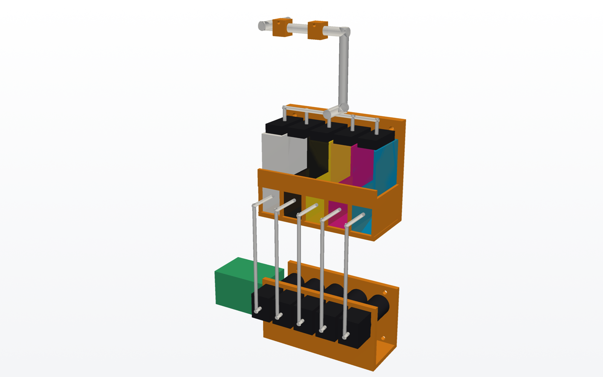 |
| **Botellas de 1 L** en una repisa detrás de la máquina | **Bombas peristálticas y subdepósitos** con flotador en la placa izquierda |
| 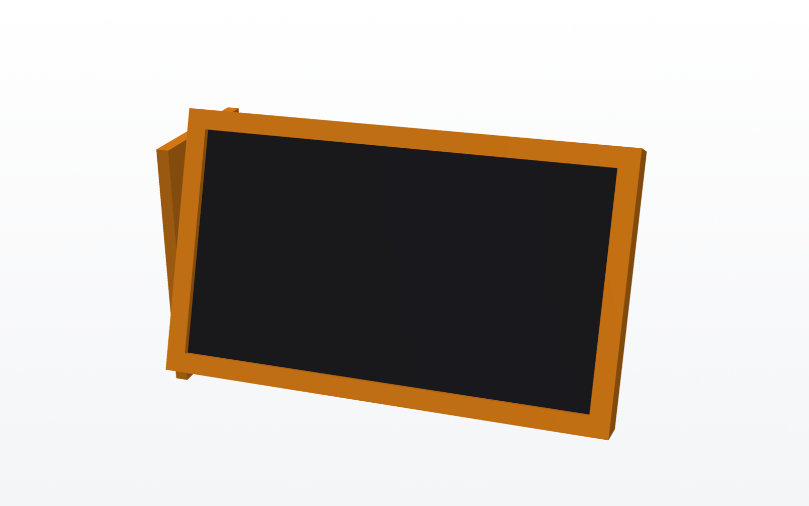 | 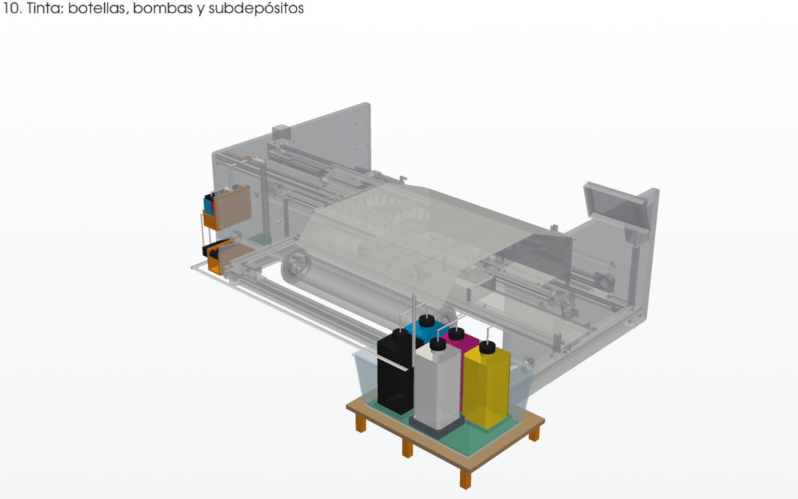 |
| **Pantalla táctil de 7"** con KlipperScreen | **Esquema de montaje**: cada paso en color sobre lo ya montado |
| 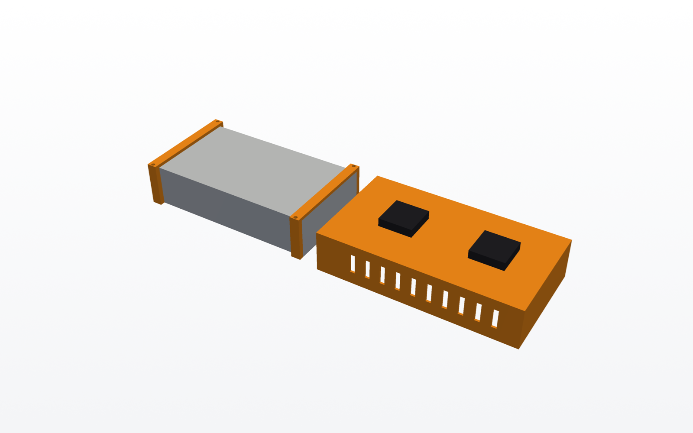 | 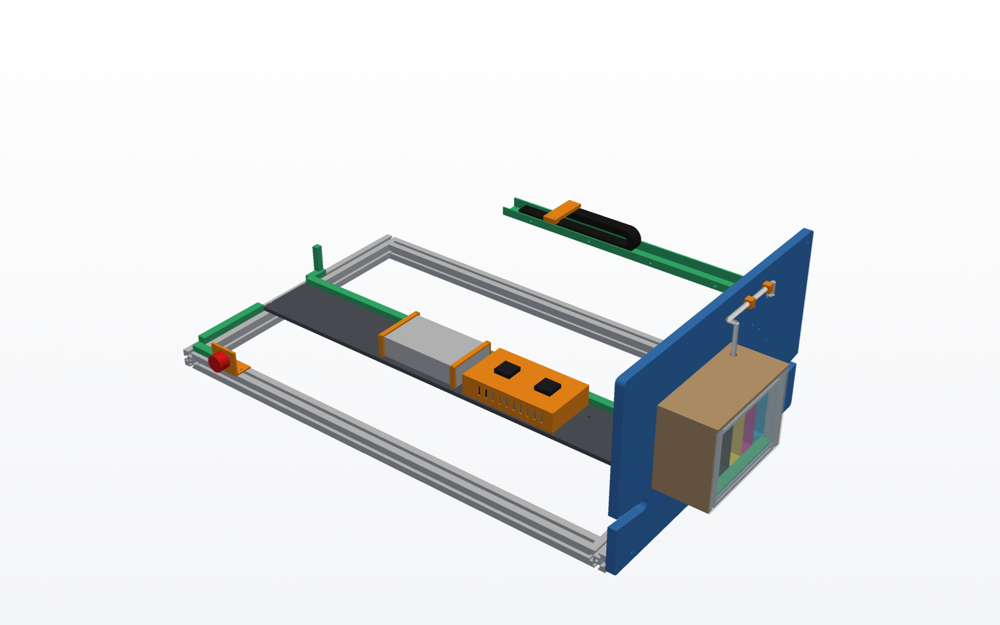 |
| **Caja de electrónica y fuente** bajo la mesa | **Canaletas**, paneles de red y emergencia y cadena portacables |

El modelo 3D completo está en [`docs/model/openprinter.glb`](docs/model/openprinter.glb)
(GitHub lo muestra en 3D al abrirlo) y en un solo STL en
[`docs/model/openprinter_completo.stl`](docs/model/openprinter_completo.stl); el sistema de
tinta solo, en [`tinta_completo.stl`](docs/model/tinta_completo.stl). Los STL de cada pieza
impresa están en [`docs/stl/`](docs/stl).

**Montaje**: [docs/montaje.md](docs/montaje.md) explica los 10 pasos con un esquema por paso
y la tabla de piezas de cada uno. En `docs/montaje.html` está la versión interactiva en 3D:
ves cada paso montándose y, al pulsar una pieza, qué es, en qué paso va y su STL. En `docs/index.html` hay además una página de
presentación con visor 3D; para verla, sírvela en local desde la carpeta `docs/`
(por ejemplo `python -m http.server`) y abre `http://localhost:8000`.

## Lista de compra

Las listas de compra se calculan a partir del modelo: perfiles con sus
longitudes, placas, guías, correas, rodamientos, ejes, tornillería, sensores y
gramos de filamento. Son estimaciones orientativas:

| Fase | Lista | Aprox. |
|---|---|---:|
| 0 · mecánica | [MD](docs/compra_fase0.md) · [CSV](docs/compra_fase0.csv) | ~550 € |
| 1 · movimiento, tinta y electrónica | [MD](docs/compra_fase1.md) · [CSV](docs/compra_fase1.csv) | ~290 € |

La fase 1 cuenta a 0 € la placa de control, la Raspberry Pi, los motores, la
fuente y las correas, porque se reutilizan de impresoras 3D. Ninguna incluye
cabezales ni tintas.

**Comprar en Reino Unido**: [compra_uk.md](docs/compra_uk.md) tiene enlaces de
Amazon UK, eBay UK y AliExpress, proveedores de perfil cortado a medida y el
orden de compra recomendado.

## Cabezales y tinta

- **Un cabezal Epson XP600** con CMYK y dos canales de blanco (`HEAD_COUNT = 1`).
  El carro y el recorrido tienen hueco para un segundo XP600 dedicado al blanco
  (`HEAD_SLOTS = 2`), que se añade con `HEAD_COUNT = 2` sin tocar el chasis.
  Las pruebas se hacen directamente en DTF. El análisis de alternativas
  (impresora donante, i1600/i3200, placas cerradas o abiertas) está en
  [docs/cabezales.md](docs/cabezales.md).
- **Tinta a granel con relleno automático**, como en las DTF comerciales:
  - **Botellas de 1 L**: las del fabricante, con un tapón con salida de tubo y
    respiradero. Van en una caja de plástico comprada (vale cualquiera de unos
    395 × 255 mm o mayor), que hace de bandeja antiderrames. La caja va en una
    repisa detrás de la máquina, a la derecha, fuera del ancho del rollo para
    poder cargarlo desde atrás. El blanco va sobre un agitador magnético.
  - **Bombas**: una peristáltica de 12 V por color, por fuera de la placa
    izquierda.
  - **Subdepósitos**: uno de ~100 ml con flotador por color, también por fuera
    de la placa izquierda. Cuando el flotador baja, su bomba rellena.
  - **Presión**: el subdepósito está a altura fija y es lo que fija la presión
    en las boquillas, con el nivel unos 40 mm por debajo. Por eso da igual
    dónde estén las botellas y nunca hay que rellenar a mano.
  - **Recorrido**: los tubos suben a la cadena portacables, que los lleva al
    carro.
  - **Control**: Klipper usa la Raspberry Pi como segunda MCU. Las bombas van
    por un módulo MOSFET desde sus GPIO y los flotadores a otros GPIO.
- **Electrónica y cables**: bajo la mesa de vacío, en una bandeja de MDF de lado
  a lado. A la izquierda va una caja impresa con la placa de control, la
  Raspberry Pi y los convertidores; a la derecha, la fuente de 24 V. Los cables
  van ocultos en canaletas impresas, por la cadena portacables y por las
  ranuras de los perfiles. Detrás está la entrada de red con fusible y delante
  la seta de emergencia. Una **pantalla táctil de 7"** con KlipperScreen va en
  la esquina delantera derecha para las funciones básicas sin ordenador.
- **Film**: el rollo va detrás, dentro del chasis, entre las dos placas y bajo
  la mesa. El film impreso no se enrolla, porque la tinta está húmeda hasta el
  polvo y el horno: baja por una rampa y cae por delante, a una bandeja o, más
  adelante, a la agitadora de polvo. Con la cubierta (fase 6) quedan cerrados; el film DTF es sensible a la
  humedad, así que conviene un sobre de gel de sílice dentro y guardar el rollo
  en su bolsa cuando no se usa.

## Fabricación low cost (primera máquina)

- **Placas laterales de MDF de 19 mm** en lugar de aluminio. La plantilla a
  tamaño real está en
  [`docs/plantillas/placa_lateral_A4.pdf`](docs/plantillas/placa_lateral_A4.pdf):
  se imprime en A4 al 100 %, se empalma, se pega sobre el MDF y se cortan las
  dos placas juntas con caladora. Los rodamientos del rodillo van en
  alojamientos impresos atornillados por dentro, no en el MDF.
- **Material de impresora 3D reutilizado** ([inventario](docs/inventario.md)): placa SKR Mini E3 V3.0, Raspberry Pi 3,
  motores NEMA17, fuente de 24 V, correas y poleas.
- Cuando el diseño esté validado, las placas pasan a aluminio cambiando
  `SIDE_PLATE_MATERIAL = "aluminio"` en `params.py`.

## Firmware

[firmware/](firmware/README.md) tiene la configuración de Klipper de la fase 1:
- la placa SKR Mini E3 V3.0 y la Raspberry Pi como segunda MCU;
- macros de vacío, film, trabajos y pruebas;
- el relleno automático de tinta con avisos de botella vacía;
- el menú de la pantalla táctil.

También explica cómo instalarlo, el cableado y el primer arranque. Aún no se ha
probado en la máquina.

## Medidas principales (film de 600 mm)

| | |
|---|---|
| Ancho imprimible | 580 mm |
| Recorrido del carro | 820 mm |
| Dimensiones exteriores | ~1415 × 1025 × 480 mm (con la repisa de botellas detrás, las bombas y la pantalla) |
| Guías | 2 × MGN12, 1000 mm |
| Placas laterales | 2 × MDF de 19 mm, 690 × 430 mm (aluminio de 10 mm en la versión final) |

## Cómo generar el modelo

Requiere Python 3.11.

```
python -m venv .venv
.venv\Scripts\pip install -r requirements.txt
.venv\Scripts\python cad\layout.py      # STEP, GLB, DXF, STL, lista de corte
.venv\Scripts\python cad\bom.py         # listas de compra (docs/)
.venv\Scripts\python cad\plantillas.py  # plantillas de corte A4 (docs/plantillas/)
.venv\Scripts\python cad\render_pv.py   # renders de presentación (docs/img/)
.venv\Scripts\python cad\web.py         # modelo 3D de la web (docs/model/)
.venv\Scripts\python cad\render.py      # vistas rápidas de trabajo (out/)
```

En Linux o macOS se usa `.venv/bin/` en lugar de `.venv\Scripts\`.

Se genera en `out/` (no se versiona):

| Archivo | Contenido |
|---|---|
| `layout.step`, `layout.glb` | Ensamblaje completo, para FreeCAD, Fusion, etc. |
| `placa_lateral.dxf` | Placa lateral, lista para cortar |
| `mesa_placa.dxf` | Placa perforada de la mesa de vacío |
| `lista_corte.csv` | Perfiles con longitudes y mecanizados |
| `stl/*.stl` | Piezas impresas |
| `layout_*.png` | Vistas rápidas |

## Estructura

```
cad/
├── params.py     cotas globales (lo único que hay que tocar para escalar)
├── lib.py        perfil serie 40, escuadras, patas, utilidades
├── layout.py     ensamblaje general y exportación
├── chassis.py    chasis (0.2)
├── xaxis.py      viga X (0.3)
├── carriage.py   carro (0.4)
├── platen.py     mesa de vacío (0.5)
├── yfeed.py      arrastre Y (0.6)
├── rolls.py      rollos y guías (0.7)
├── service.py    estación de servicio y reserva de tinta (0.8)
├── motion.py     encoders, final de carrera y cadena portacables (fase 1)
├── wiring.py     electrónica, fuente, paneles y canaletas (fase 1)
├── ink.py        tinta: botellas, bombas peristálticas y subdepósitos (fase 1)
├── montaje.py    pasos de montaje y catálogo de piezas (web y montaje.md)
├── bom.py        lista de compra
├── render_pv.py  renders de presentación
├── web.py        modelo 3D de la web
└── render.py     vistas rápidas de trabajo
firmware/
└── klipper/      printer.cfg, macros, tinta y menú de KlipperScreen
docs/
├── index.html    página de presentación con visor 3D
├── montaje.html  montaje interactivo en 3D; montaje.md, la guía en texto
├── compra_fase0.md / .csv, compra_fase1.md / .csv
├── fase1_movimiento.md   arquitectura de la fase 1
├── img/          renders y esquemas de montaje
├── stl/          STL de cada pieza impresa
└── model/        openprinter.glb, STL completos y montaje.json
```

## Seguridad

- **Polvo adhesivo y curado**: al calentarse desprende humos. Trabaja con
  extracción o filtro de carbón y nunca cures en un espacio cerrado sin
  ventilación.
- **Tintas**: usa guantes y gafas, y consulta la ficha de seguridad de la tinta
  que compres.
- **Driver del cabezal**: trabaja con tensiones de 30–40 V y corrientes de pico
  altas. Cuando se publique, sigue sus instrucciones.
- **Partes móviles**: el carro se mueve rápido. Durante las pruebas, mantén las
  manos fuera de su recorrido.

## Contribuir

Se aceptan issues y pull requests. Especialmente útil ahora:

- Mediciones reales del cabezal XP600: cuerpo, pestaña, tornillos y altura de
  las boquillas.
- Revisión del diseño mecánico: rigidez, fabricabilidad, costes.

No subas documentación, firmware ni archivos con copyright de fabricantes.
Las mediciones, fotos y análisis propios sí son bienvenidos.

## Licencias

- **Hardware** (modelos CAD, planos, DXF, STL): CERN-OHL-S v2, en
  [LICENSE-HARDWARE](LICENSE-HARDWARE).
- **Software y firmware**: GPL-3.0, en [LICENSE](LICENSE).

---

## English summary

OpenPrinter is an open source **DTF (Direct To Film) printer** designed from
scratch for makers:

- 600 mm roll film, configurable to 330 mm (A3+).
- CMYK + white with one Epson XP600 piezo head (CMYK + WW), with room for a
  second, white-only head.
- 4040 aluminium extrusion frame, laser or waterjet-cut side plates and
  3D-printed carriage and brackets.
- Parametric CAD in Python (CadQuery), exported to STEP, STL and DXF.
- Planned: open electronics (Raspberry Pi + RP2040/STM32), an open RIP, an
  open XP600 head driver, white ink recirculation, and powder/curing modules.

**Status:** phase 0, mechanical design only. Nothing has been built or tested
yet. Licences: CERN-OHL-S v2 for hardware, GPL-3.0 for software.
