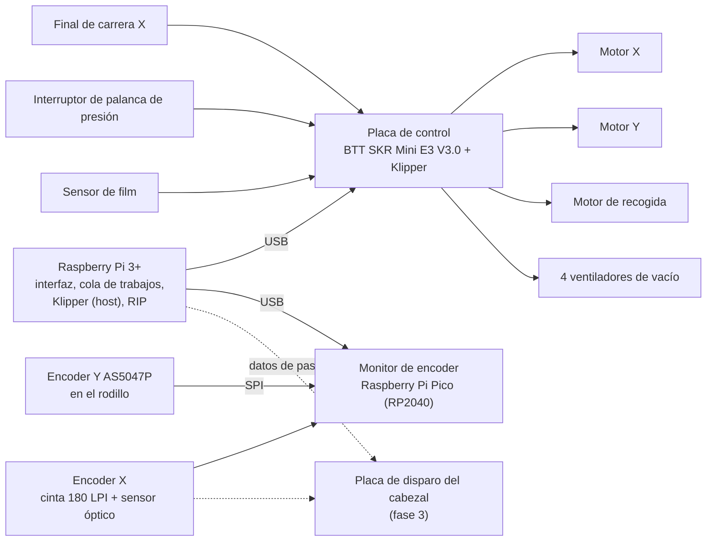
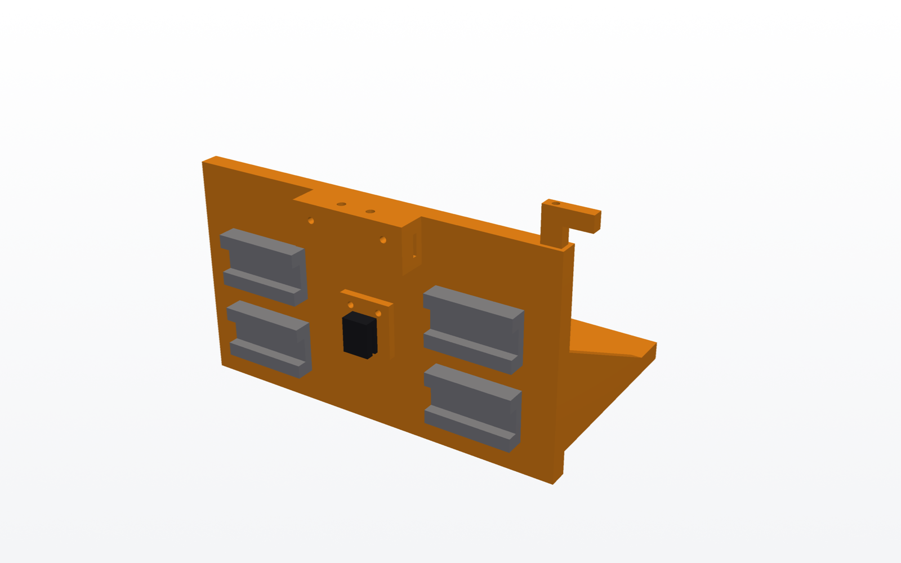
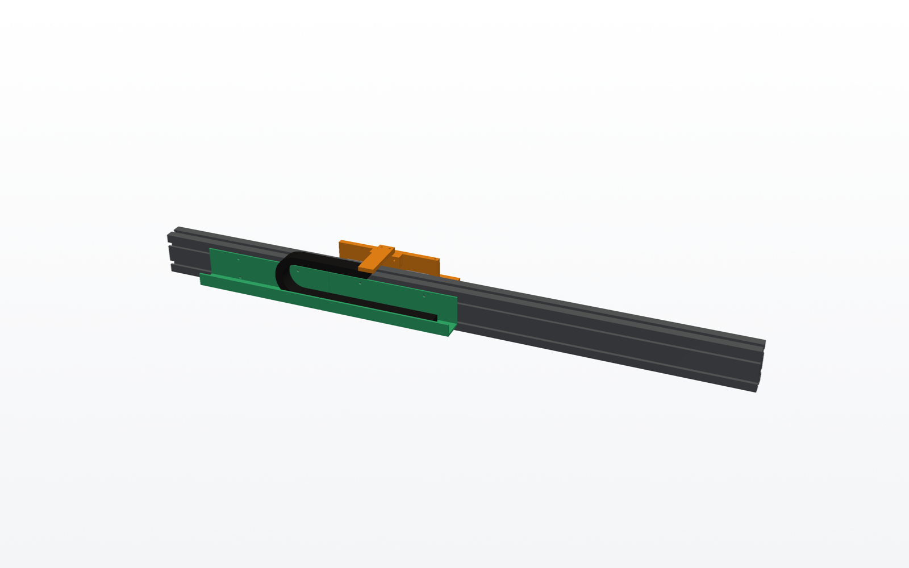
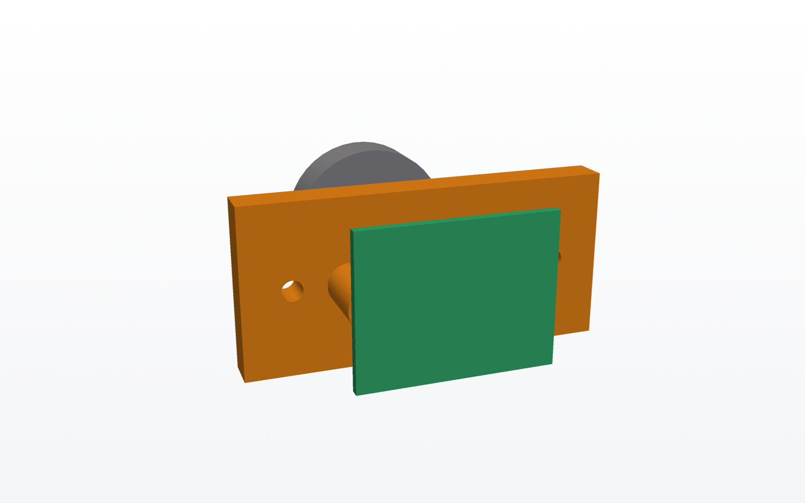
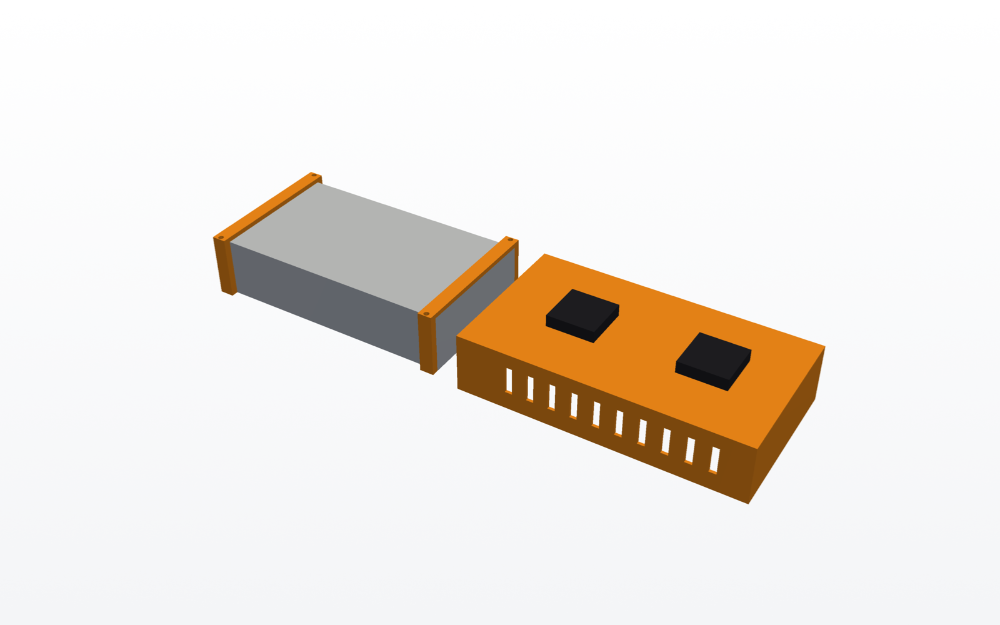

# Fase 1: movimiento

Objetivo: que la máquina se mueva como una impresora de verdad, todavía sin
cabezal. El carro barre el film a velocidad constante con su posición leída por
un encoder lineal, y el film avanza pasos precisos medidos por un encoder en el
rodillo.

**Hito**: 1000 pasadas seguidas a 0,6 m/s con el rizado de velocidad medido y
avances de film con error por debajo del 0,05 %, registrados desde la Raspberry Pi.

## Arquitectura

La idea clave es **separar el movimiento del disparo**:

- **Klipper** mueve los motores. Está probado, tiene *input shaping* y se
  configura con un archivo de texto. No necesita saber nada del cabezal.
- **El encoder X manda.** El cabezal no dispara según los pasos del motor, sino
  según la posición real que lee el encoder. Así, las irregularidades del motor
  o de la correa no se ven en la impresión.
- En la fase 1, el encoder X lo lee un **Raspberry Pi Pico** (con su PIO cuenta
  la cuadratura sin perder pulsos). Registra la posición y la velocidad de cada
  pasada para medir la calidad del movimiento. En la fase 3 ese mismo
  microcontrolador (o una FPGA) es la base de la placa de disparo.

## Componentes

**Se reutiliza material de impresora 3D.** La fase 1 está pensada para montarse
con lo que suele haber en un taller con impresoras 3D:

- **Raspberry Pi 3**: suficiente para Klipper y la interfaz web. Solo cuando
  llegue el RIP (fase 2) puede hacer falta una Pi 4 o 5 para procesar imágenes
  grandes.
- **Cualquier placa de impresora 3D compatible con Klipper** (SKR, MKS, Creality,
  Octopus…) con al menos 3 drivers: X, Y y recogida. Si no tiene 4 salidas de
  ventilador libres, los ventiladores de vacío se gobiernan con un módulo de
  MOSFET desde pines libres.
- **Motores NEMA17, correas y poleas GT2** de impresora 3D. La correa X está
  dibujada de 10 mm, pero una GT2 de 6 mm de fibra de vidrio vale para la fase 1;
  si a 0,6 m/s se nota elasticidad en las inversiones, se cambia por una de 9 o
  10 mm.

| Bloque | Elección | Por qué |
|---|---|---|
| Host | Raspberry Pi 3 o superior | Klipper, interfaz web y, más adelante, el RIP |
| Placa de control | BTT SKR Mini E3 V3.0 con Klipper (del inventario) | 4 drivers TMC2209: X, Y, recogida y uno libre; si más adelante faltan salidas, una Octopus da 8 drivers |
| Drivers | TMC2209 en UART, 24 V | Silenciosos y con corriente configurable; si el eje X se queda corto, TMC5160 |
| Motor X | NEMA17 de 40 mm (del inventario) | Ver cálculo abajo; uno de 48 mm da más margen |
| Motor Y | NEMA17 de 40 mm (del inventario) | Con la reducción 4:1 le sobra par |
| Motor de recogida | NEMA17 de 40 mm (fase 1.5, del inventario) | Controlado por un brazo de tensión (*dancer*) |
| Encoder X | Cinta de 180 LPI + sensor óptico de cuadratura (tipo H9730) | Estándar en impresoras de inyección; se pueden sacar de impresoras rotas |
| Encoder Y | AS5047P magnético en el extremo del eje del rodillo | 14 bits: 5,8 µm de film por cuenta; lo lee el Pico por SPI |
| Final de carrera X | Sensor óptico de horquilla + bandera en el carro | Sin contacto y repetible; marca el *home* junto a la estación de servicio |
| Sensor de film | Reflexivo (TCRT5000) bajo la mesa de entrada | Detecta fin de rollo |
| Palanca de presión | Microinterruptor | Impide mover el eje Y con las ruedas levantadas |
| Alimentación | Fuente de 24 V de impresora 3D (del inventario) | Motores, ventiladores de 24 V y placa; con 200 W o más basta |
| 5 V | Convertidor 24 → 5 V de 5 A | Raspberry Pi y Pico |
| Seguridad | Seta de emergencia NC que corta los 24 V de los motores | Para el carro al instante |

## Números que justifican el diseño

**Velocidad del carro.** Un XP600 dispara a unos 8 kHz (dato a confirmar en la
fase 3). Con pasadas de 360 ppp, la velocidad máxima útil es
8000 / 360 = 22 pulgadas/s ≈ **0,56 m/s**. El objetivo es 0,6 m/s.

**Aceleración y margen.** A 10 m/s², alcanzar 0,6 m/s necesita
v² / 2a = **18 mm**. La zona de aceleración del modelo es de 60 mm a cada lado,
así que hay margen para acelerar más suave o subir la velocidad.

**Motor X.** El carro con cabezales, dampers y tinta pesa unos 1,2 kg. Para
acelerar a 10 m/s² hacen falta 12 N; con la polea de 20 dientes (radio
6,4 mm) son 0,08 N·m. A 0,6 m/s la polea gira a 900 rpm. Un NEMA17 de 40 mm
a 24 V da unos 0,12–0,15 N·m a esas vueltas: margen de 1,5 a 1,9 veces, justo
pero suficiente. Si en las pruebas pierde pasos, se baja la aceleración a
6 m/s² (necesita 30 mm de los 60 de margen) o se cambia por uno de 48 mm.

**Resolución X.** 180 líneas por pulgada con decodificación ×4 dan
720 cuentas por pulgada: **35 µm por cuenta**. La placa de disparo interpola
entre cuentas para colocar gotas a 720 ppp o más.

**Resolución Y.** Con la reducción 4:1 y el rodillo de Ø30, el motor avanza
23,6 mm por vuelta: 7,4 µm por micropaso a 1/16. El AS5047P mide 5,8 µm por
cuenta en el rodillo, que es lo que de verdad importa: la referencia es el
rodillo, no el motor.

## Señales en la placa de control

Necesidades mínimas: 3 drivers, 3 entradas digitales, 1 analógica y salidas
para los ventiladores. La placa elegida es la **BTT SKR Mini E3 V3.0** del
inventario (ver [inventario.md](inventario.md)): 4 drivers TMC2209 en UART, y
las salidas de calentador sirven como interruptores de 24 V para los
ventiladores de vacío.

| Señal | Tipo | Conector SKR Mini E3 V3.0 |
|---|---|---|
| Motor X | paso/dirección + UART | X |
| Motor Y | paso/dirección + UART | Y |
| Motor de recogida | paso/dirección + UART | Z |
| (libre: bomba o agitador del blanco, fase 4) | paso/dirección + UART | E |
| Final de carrera X | entrada digital | X-STOP |
| Interruptor de palanca de presión | entrada digital | Y-STOP |
| Sensor de film | entrada digital | E0-STOP (la entrada de fin de filamento) |
| Brazo de tensión de recogida | entrada analógica | TH0 |
| Ventiladores de vacío centrales (2) | 24 V conmutado | HE0 |
| Ventiladores de vacío laterales (2) | 24 V conmutado | HB |
| Ventilador de la electrónica | PWM | FAN0 |

- Los ventiladores de vacío van en dos grupos: los dos centrales se encienden
  con cualquier ancho de film y los dos laterales solo con film de 60 cm.
- **El encoder Y (AS5047P) va al Raspberry Pi Pico por SPI**, junto con el
  encoder X: así todas las medidas de posición están en el mismo
  microcontrolador y la SKR no necesita SPI libre.
- Los ventiladores 4010 del inventario son de 12 V. Para enfriar la
  electrónica, aliméntalos desde la fuente de 12 V o con un convertidor
  24 → 12 V; o usa uno de 24 V en FAN0.

La asignación definitiva de pines se hará con el `printer.cfg` de Klipper,
comprobando el esquema oficial de la placa.

## Cómo va colocado

- **Cinta del encoder X**: a lo largo de la cara delantera de la viga, entre las
  dos guías. Va sujeta en los extremos con soportes impresos, uno de ellos con
  muelle para tensarla. El sensor va en la cara trasera de la placa del carro,
  entre los patines.
- **Final de carrera X**: sobre el soporte de la polea loca, a la derecha. La
  bandera es una aleta impresa en la parte alta del carro.
- **Encoder Y**: el eje del rodillo sale 13 mm por fuera de la placa izquierda.
  Lleva un imán diametral en la punta, y la placa del AS5047P va en un soporte
  impreso atornillado a la placa lateral.
- **Cadena portacables X**: en una bandeja impresa detrás de la viga. Va
  anclada en el centro del recorrido y sube hasta un brazo impreso que sale de
  la pinza de correa del carro, por encima de la viga.
- **Electrónica**: en una placa de montaje bajo la mesa de vacío, atornillada
  al travesaño central, con la fuente, la Octopus, la Raspberry Pi y el
  convertidor de 5 V.

| | |
|---|---|
|  |  |
| Sensor del encoder X entre los patines y bandera del final de carrera | Cadena portacables en su bandeja detrás de la viga |
|  |  |
| Encoder Y: AS5047P frente al imán en la punta del eje del rodillo | Placa de electrónica: fuente, placa de control, Raspberry Pi, Pico y 5 V |

Piezas impresas de esta fase (STL en `out/stl/`): soportes de la cinta del
encoder (2), soporte del sensor del encoder, bandera y soporte del final de
carrera, soporte del encoder Y, bandeja de la cadena (2) y brazo de la cadena.
Unos 200 g de filamento en total.

## Pruebas de la fase 1

1. **Movimiento X**: 1000 pasadas a 0,6 m/s. El Pico registra la velocidad en
   la zona central; se busca un rizado por debajo del 1 % y que la posición de
   cada inversión se repita en ±1 cuenta.
2. **Avance Y**: 100 avances de 6,35 mm comparando lo que ordena Klipper, lo
   que mide el AS5047P y unas marcas en el film medidas con calibre. Objetivo:
   error acumulado por debajo del 0,05 %.
3. **Arrastre recto**: 2 m de film sin que se desvíe más de 1 mm de lado.
4. **Vacío**: el film queda plano en las 4 zonas, y apagando las de los lados
   con film estrecho.
5. **Seguridad**: la seta para los motores en cualquier punto del recorrido.

## Fuera de esta fase

- El cabezal, la placa de disparo y el RIP (fases 2 y 3).
- La recogida motorizada queda como fase 1.5: primero se prueba con recogida
  manual o por peso.
