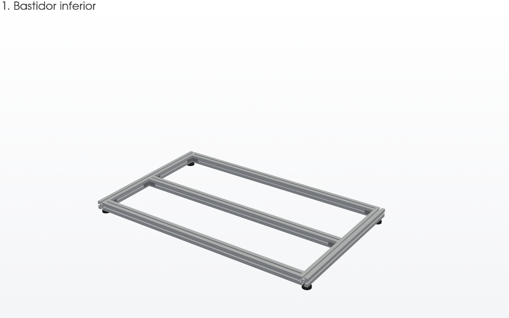
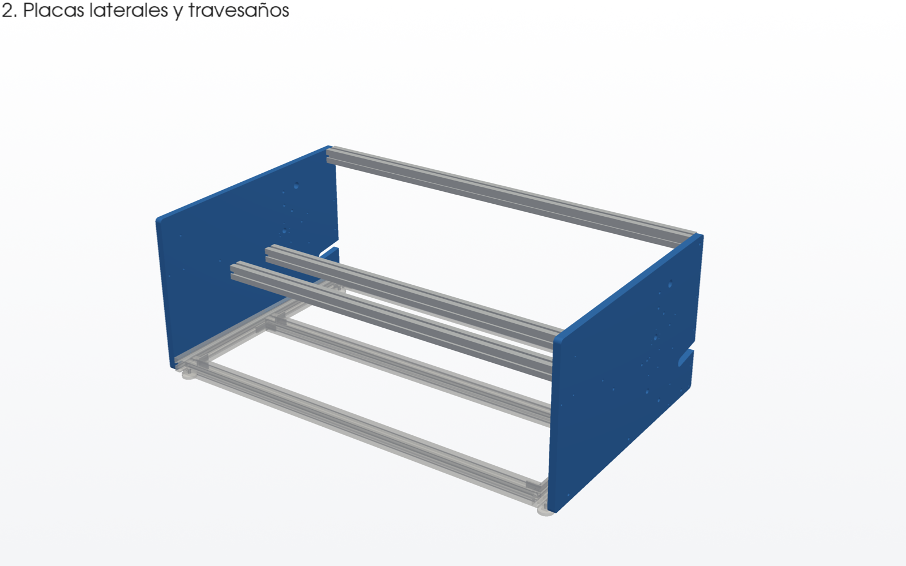
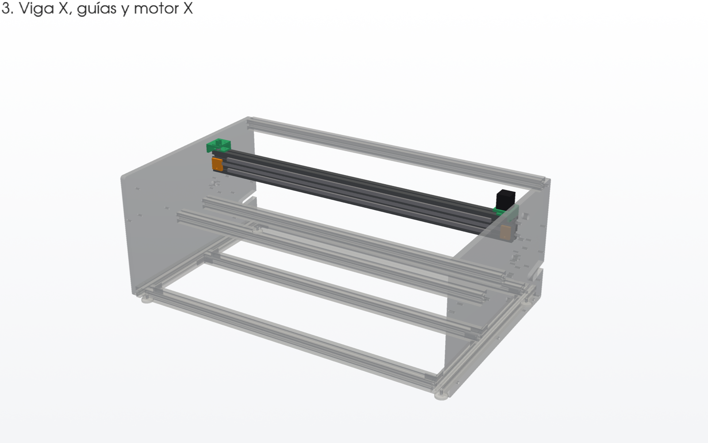
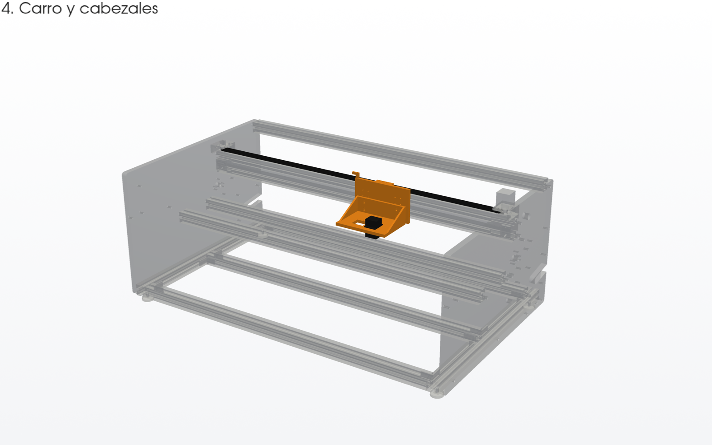
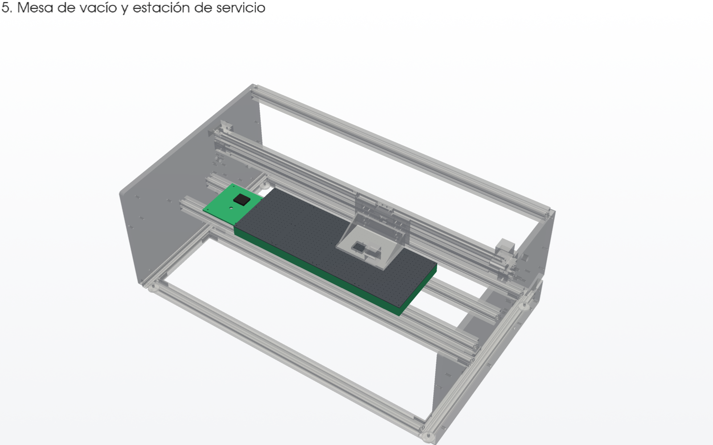
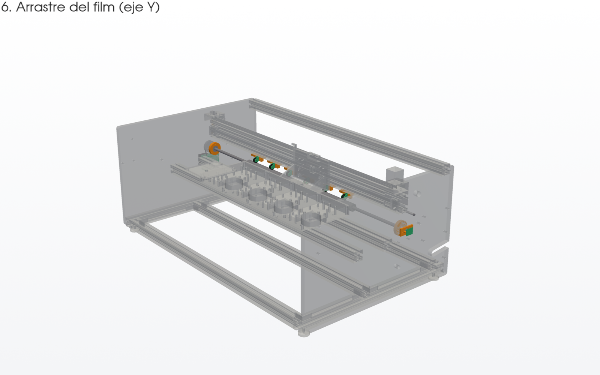
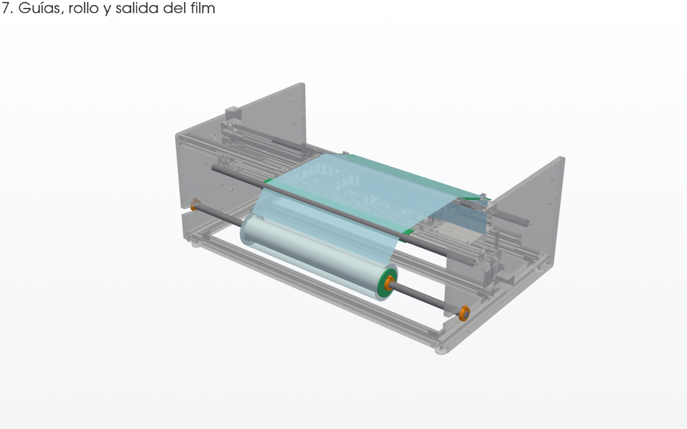
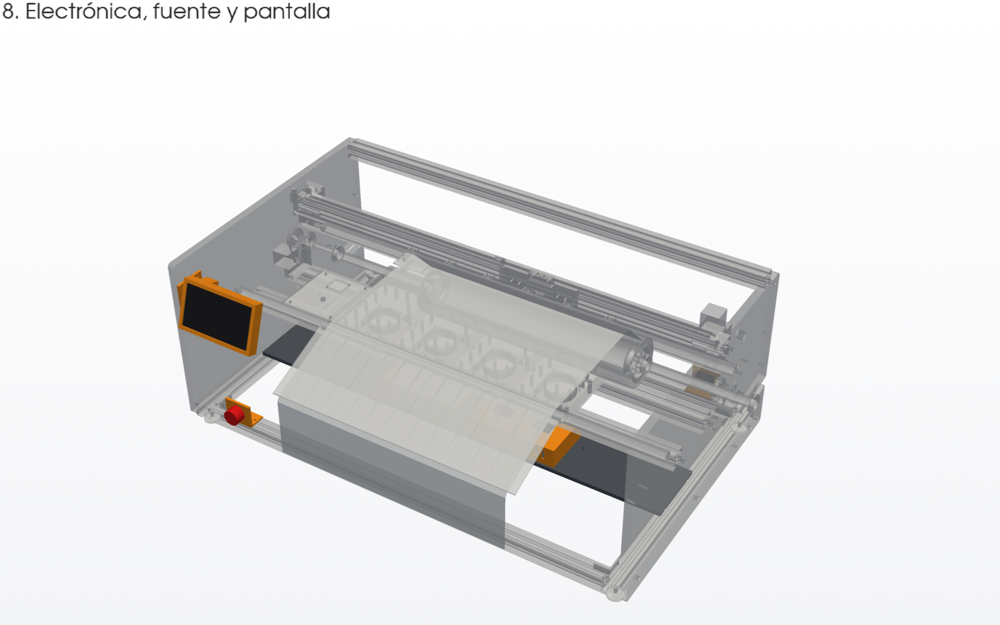
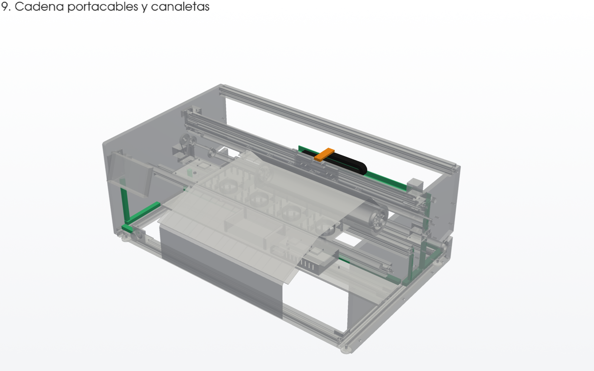
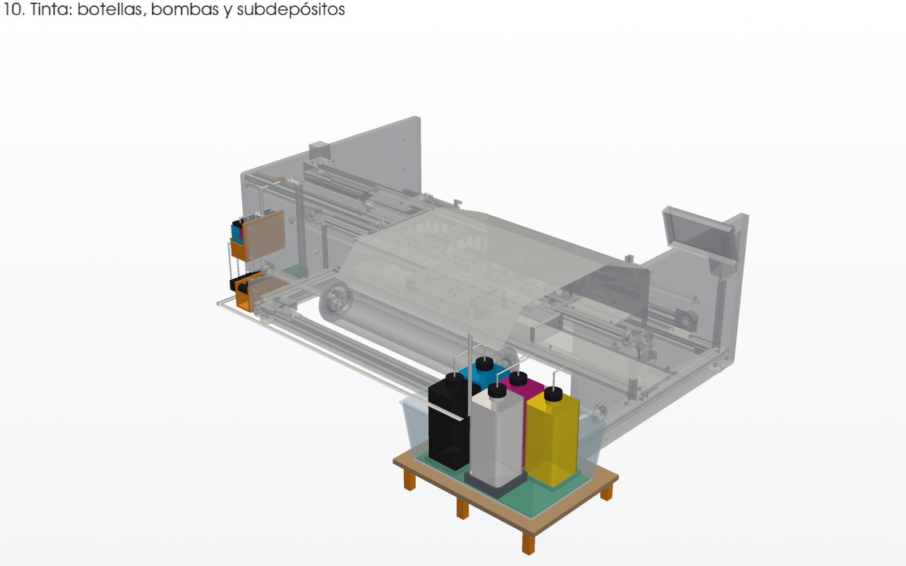

# Guía de montaje

Generada por `cad/montaje.py` a partir del modelo. En [montaje.html](montaje.html) está la versión interactiva en 3D: pulsa una pieza para ver qué es, en qué paso va y descargar su STL.

En cada esquema, lo montado en pasos anteriores sale en gris y lo de ese paso, en color.

## 1. Bastidor inferior

Corta los perfiles 4040 según la lista de corte. Une los largueros delantero, trasero y el travesaño central a los dos largueros laterales con escuadras. Antes de apretar, comprueba que las dos diagonales miden lo mismo (±1 mm). Enrosca las patas niveladoras en la ranura inferior de los largueros laterales.

**Tornillería y material:** Escuadras 4040 con tornillo M8 x 16 y tuerca en T M8; 4 patas niveladoras M8.

| Pieza | Cant. | STL |
|---|---:|---|
| Larguero lateral izquierdo 4040 | 1 |  |
| Larguero lateral derecho 4040 | 1 |  |
| Larguero trasero 4040 | 1 |  |
| Travesaño central 4040 | 1 |  |
| Larguero delantero 4040 | 1 |  |
| Escuadra 4040 | 8 |  |
| Pata niveladora M8 | 4 |  |

## 2. Placas laterales y travesaños

Corta y taladra las dos placas de MDF de 19 mm con la plantilla A4 a escala 1:1. Atorníllalas a los largueros laterales. Rosca M8 en las testas de los dos travesaños de la mesa y del tirante superior, y atorníllalos desde fuera de las placas. Mide la separación interior entre placas arriba y abajo: debe ser 1140 mm.

**Tornillería y material:** M8 x 35 + arandela + tuerca en T M8 (3 por placa); M8 x 40 en las testas (6).

| Pieza | Cant. | STL |
|---|---:|---|
| Placa lateral izquierda, MDF 19 mm | 1 |  |
| Placa lateral derecha, MDF 19 mm | 1 |  |
| Tirante superior trasero 4040 | 1 |  |
| Travesaño de la mesa 4040 | 2 |  |

## 3. Viga X, guías y motor X

Rosca 2 x M8 en cada testa de la viga 4080 y atorníllala entre las placas. Fija la guía MGN12 de arriba en la cara delantera con tornillos cada 25 mm, alineada con una regla. Coloca la de abajo paralela a la primera, midiendo con calibre a lo largo de todo el recorrido. Monta el soporte del motor X a la izquierda y el del tensor a la derecha. Pon la cinta del encoder en sus soportes, tensa y sin tocar la viga, y el soporte del sensor de final de carrera.

**Tornillería y material:** M8 x 40 (4); M3 x 8 + tuerca en T M3 (80); M5 x 10 + tuerca en T M5 (8); Polea GT2 20T y polea loca.

| Pieza | Cant. | STL |
|---|---:|---|
| Viga X 4080 | 1 |  |
| Guía lineal MGN12 | 2 |  |
| Soporte del motor X | 1 | [soporte_motor_x.stl](stl/soporte_motor_x.stl) |
| Soporte del tensor X | 1 | [soporte_tensor_x.stl](stl/soporte_tensor_x.stl) |
| Motor NEMA17 del eje X | 1 |  |
| Polea GT2 20T del motor X | 1 |  |
| Polea loca GT2 del tensor X | 1 |  |
| Cinta del encoder 180 LPI | 1 |  |
| Soporte izquierdo de la cinta del encoder | 1 | [encoder_soporte_cinta_izq.stl](stl/encoder_soporte_cinta_izq.stl) |
| Soporte derecho de la cinta del encoder | 1 | [encoder_soporte_cinta_der.stl](stl/encoder_soporte_cinta_der.stl) |
| Soporte del sensor de home X | 1 | [final_x_soporte.stl](stl/final_x_soporte.stl) |

## 4. Carro y cabezales

Mete los patines MGN12H en las guías sin sacarlos de su tapón: si se salen, se pierden las bolas. Atornilla la placa del carro a los 4 patines y la bandeja de los cabezales con el ajuste de altura a media carrera. Cierra la correa GT2 de 10 mm en la pinza y ténsala. Monta el sensor del encoder y la bandera de home en el carro.

**Tornillería y material:** M3 x 10 (16) para los patines; M3 + insertos térmicos para sensor y bandera.

| Pieza | Cant. | STL |
|---|---:|---|
| Correa GT2 10 mm del eje X | 1 |  |
| Patín MGN12H | 4 |  |
| Placa del carro | 1 | [carro_placa.stl](stl/carro_placa.stl) |
| Bandeja de cabezales | 1 | [carro_bandeja.stl](stl/carro_bandeja.stl) |
| Pinza de la correa | 1 | [carro_pinza_correa.stl](stl/carro_pinza_correa.stl) |
| Cabezal Epson XP600 | 1 |  |
| Soporte del sensor del encoder X | 1 | [encoder_soporte_sensor.stl](stl/encoder_soporte_sensor.stl) |
| Sensor del encoder X | 1 |  |
| Bandera de home X | 1 | [final_x_bandera.stl](stl/final_x_bandera.stl) |

## 5. Mesa de vacío y estación de servicio

Atornilla las 4 cámaras impresas a los travesaños de la mesa, cada una con su ventilador de 80 mm debajo. Encima va la placa de aluminio perforada: sella el borde con cinta de espuma para que el vacío no se escape. La estación de servicio va a la derecha, bajo la posición de home del carro.

**Tornillería y material:** M4 + tuerca en T M4 para las cámaras; Cinta de espuma de 3 mm.

| Pieza | Cant. | STL |
|---|---:|---|
| Placa perforada de aluminio de la mesa | 1 |  |
| Cámara de vacío impresa | 4 | [mesa_camara.stl](stl/mesa_camara.stl) |
| Ventilador 80 mm 24 V de la mesa | 4 |  |
| Base de la estación de servicio | 1 | [servicio_base.stl](stl/servicio_base.stl) |
| Tapas de limpieza | 1 |  |

## 6. Arrastre del film (eje Y)

Atornilla los alojamientos de los rodamientos 6001 por dentro de las placas. Pasa el eje de 12 mm con el rodillo de arrastre. Fuera de la placa derecha van la polea de 80 dientes, el motor Y con su soporte y la correa de 6 mm. Monta el eje de levante de 8 mm con las 6 levas y las 6 unidades de presión. Termina con la palanca y el imán del encoder Y en la punta izquierda del eje; el sensor AS5047P queda a 1-2 mm del imán.

**Tornillería y material:** M4 x 30 (6) para los alojamientos; M5 x 30 (4) para el soporte del motor Y; Rodamientos 6001 (2).

| Pieza | Cant. | STL |
|---|---:|---|
| Soporte del encoder Y | 1 | [encoder_y_soporte.stl](stl/encoder_y_soporte.stl) |
| Imán diametral del encoder Y | 1 |  |
| Placa AS5047P del encoder Y | 1 |  |
| Eje del rodillo de arrastre Ø12 | 1 |  |
| Rodillo de arrastre Ø30 | 1 |  |
| Rodamiento 6001 | 2 |  |
| Alojamiento del rodamiento 6001 | 2 | [rodillo_alojamiento_6001.stl](stl/rodillo_alojamiento_6001.stl) |
| Soporte de la unidad de presión | 6 | [presion_soporte.stl](stl/presion_soporte.stl) |
| Brazo de la unidad de presión | 6 | [presion_brazo.stl](stl/presion_brazo.stl) |
| Rueda de presión | 6 | [presion_rueda_tpu.stl](stl/presion_rueda_tpu.stl) |
| Leva de levante | 6 | [presion_leva.stl](stl/presion_leva.stl) |
| Muelle de la unidad de presión | 6 |  |
| Eje de levante Ø8 | 1 |  |
| Palanca de levante | 1 | [presion_palanca.stl](stl/presion_palanca.stl) |
| Soporte del motor Y | 1 | [soporte_motor_y.stl](stl/soporte_motor_y.stl) |
| Motor NEMA17 del eje Y | 1 |  |
| Polea GT2 80T del rodillo | 1 |  |
| Polea GT2 20T del motor Y | 1 |  |
| Correa GT2 6 mm del eje Y | 2 |  |

## 7. Guías, rollo y salida del film

Atornilla las guías de 25 mm trasera y delantera con M6 en las testas. Engancha a presión los 4 segmentos de la mesa de entrada en la guía trasera y los 4 de la rampa de salida en la delantera. Mete los mandriles en el núcleo del rollo y fíjalos con los collarines. Deja caer el eje del rollo por las ranuras traseras de las placas. Recorrido del film: rollo, guía trasera, bajo las ruedas de presión, mesa de vacío y rampa de salida, por donde cae hacia delante.

**Tornillería y material:** M6 x 30 (4); Rodamientos 6005 (2) en los mandriles.

| Pieza | Cant. | STL |
|---|---:|---|
| Guía trasera Ø25 | 1 |  |
| Guía delantera Ø25 | 1 |  |
| Segmento de la mesa de entrada | 4 | [mesa_entrada_segmento.stl](stl/mesa_entrada_segmento.stl) |
| Segmento de la rampa de salida | 4 | [mesa_salida_segmento.stl](stl/mesa_salida_segmento.stl) |
| Eje del rollo Ø25 | 1 |  |
| Rollo de film DTF de 60 cm | 1 |  |
| Núcleo de cartón de 3" | 1 |  |
| Mandril del rollo | 2 | [rollo_mandril.stl](stl/rollo_mandril.stl) |
| Collarín del mandril | 2 | [rollo_collarin.stl](stl/rollo_collarin.stl) |
| Collarín del eje en la placa | 2 | [rollo_collarin.stl](stl/rollo_collarin.stl) |
| Film DTF | 1 |  |

## 8. Electrónica, fuente y pantalla

Atornilla la bandeja de MDF de 10 mm a los largueros laterales y al travesaño central. Encima van la caja impresa con la SKR, la Raspberry Pi, el Pico y los convertidores, y la fuente de 24 V sujeta con sus dos bridas. El panel de red va en el larguero trasero y la seta de emergencia en el delantero. La pantalla va en la esquina delantera derecha: su pletina se atornilla a la placa y el brazo de la carcasa a la pletina.

**Tornillería y material:** M5 x 12 + tuerca en T M5 (6) para la bandeja; Separadores M3 de nylon (16); M5 x 30 (3) para la pantalla.

| Pieza | Cant. | STL |
|---|---:|---|
| Bandeja de electrónica, MDF 10 mm | 1 |  |
| Caja de la electrónica | 1 | [electronica_caja.stl](stl/electronica_caja.stl) |
| BTT SKR Mini E3 V3.0 | 1 |  |
| Raspberry Pi 3 | 1 |  |
| Raspberry Pi Pico | 1 |  |
| Convertidor 24 V a 5 V | 1 |  |
| Convertidor 24 V a 12 V | 1 |  |
| Fuente de 24 V | 1 |  |
| Ventilador 4010 de la caja | 2 |  |
| Brida de la fuente | 2 | [electronica_brida_fuente.stl](stl/electronica_brida_fuente.stl) |
| Panel de la entrada de red | 1 | [panel_iec.stl](stl/panel_iec.stl) |
| Conector IEC con interruptor y fusible | 1 |  |
| Panel de la seta de emergencia | 1 | [panel_seta.stl](stl/panel_seta.stl) |
| Seta de emergencia | 1 |  |
| Carcasa de la pantalla | 1 | [pantalla_carcasa.stl](stl/pantalla_carcasa.stl) |
| Pletina de la pantalla | 1 | [pantalla_soporte.stl](stl/pantalla_soporte.stl) |
| Pantalla táctil de 7" | 1 |  |

## 9. Cadena portacables y canaletas

Pega o atornilla las canaletas impresas sobre los largueros y por dentro de las placas. Monta la bandeja de la cadena portacables sobre la viga y el brazo en el carro. Por la cadena van los cables de los cabezales, el sensor del encoder y los tubos de tinta. Separa la potencia (motores, 24 V) de las señales (encoders, flat de los cabezales); el cable de los encoders, apantallado.

**Tornillería y material:** Tornillo para madera 3 x 12 para las canaletas; Bridas.

| Pieza | Cant. | STL |
|---|---:|---|
| Bandeja de la cadena portacables | 2 | [cadena_bandeja.stl](stl/cadena_bandeja.stl) |
| Cadena portacables 10 x 20 | 1 |  |
| Brazo de la cadena en el carro | 1 | [cadena_brazo.stl](stl/cadena_brazo.stl) |
| Canaleta de cables con tapa | 10 | [canaleta_tramo_200.stl](stl/canaleta_tramo_200.stl) |

## 10. Tinta: botellas, bombas y subdepósitos

Atornilla las dos escuadras de la repisa a la ranura trasera del larguero trasero; la pata apoya en la mesa de trabajo. Encima van la caja de plástico, la base impresa y las 5 botellas de 1 L, con el blanco sobre el agitador. Por fuera de la placa izquierda atornilla los soportes de las bombas y de los subdepósitos, y la caja del driver. Recorrido de cada color: botella, bomba, subdepósito, cadena portacables y carro. Para cebar, se rellenan los subdepósitos con las bombas y se aspira desde los dampers con jeringa.

**Tornillería y material:** M5 x 12 + tuerca en T M5 (2) para la repisa; M5 x 30 + arandela + tuerca (12) por la placa; Clips de tubo (2).

| Pieza | Cant. | STL |
|---|---:|---|
| Repisa de las botellas, MDF 12 mm | 1 |  |
| Escuadra de la repisa | 2 | [tinta_escuadra_repisa.stl](stl/tinta_escuadra_repisa.stl) |
| Pata de la repisa | 1 | [tinta_pata_repisa.stl](stl/tinta_pata_repisa.stl) |
| Caja de plástico | 1 |  |
| Base de las botellas | 1 | [tinta_base_botellas.stl](stl/tinta_base_botellas.stl) |
| Botella de tinta de 1 L | 5 |  |
| Tapón con salida de tubo y respiradero | 5 |  |
| Agitador magnético | 1 |  |
| Soporte de las bombas | 1 | [tinta_soporte_bombas.stl](stl/tinta_soporte_bombas.stl) |
| Bomba peristáltica 12 V | 5 |  |
| Caja del driver de las bombas | 1 | [tinta_caja_driver.stl](stl/tinta_caja_driver.stl) |
| Soporte de los subdepósitos | 1 | [tinta_soporte_subdepositos.stl](stl/tinta_soporte_subdepositos.stl) |
| Subdepósito con flotador | 5 |  |
| Tapa con sensor de nivel | 5 |  |
| Tubo de tinta | 16 |  |
| Mazo de tubos hacia el carro | 1 |  |
| Clip de tubos | 2 | [tinta_clip_tubos.stl](stl/tinta_clip_tubos.stl) |
